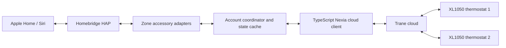

# Trane XL1050 Homebridge Plugin Implementation Plan

> Historical implementation plan, prepared before development. See the README
> and verification record for the released implementation and current status.

**Goal:** Add the owner's two single-zone XL1050 thermostats, on one Trane Home account, to Apple Home through Homebridge, with a path to the supported functionality of Home Assistant's Nexia integration.

**Architecture:** A TypeScript dynamic platform plugin owns one cloud client and coordinated state cache per account/house. It discovers thermostats and zones, publishes one HomeKit thermostat accessory per zone, and routes commands through a serialized coordinator. Port the necessary protocol behavior from the Python Nexia library; Home Assistant is not required at runtime.

**Tech Stack:** TypeScript, Homebridge/HAP supplied by Homebridge, Node.js 24 in Docker for development, native HTTP fetch with explicit session handling, runtime payload validation, Vitest with a mocked HTTP transport, and Homebridge UI configuration schema. Pin dependency versions and compatibility ranges when scaffolding.

---

## 1. Scope and evidence

Prepared October 19, 2026. Confirmed by the owner: both thermostats share an account and each controls one zone. Expected default result: exactly two independently controllable thermostat accessories, using their real Trane names with optional name overrides.

The workspace is an empty Git repository with no implementation or Docker files. This is a source review and proposed implementation, not a tested plugin or a live verification of the owner's equipment.

The knowledge graph project listing contains neither this project nor the upstream repositories. A coverage query returned “project not found or not indexed.” Review therefore used upstream source directly. Browser snapshots of mutable `dev`, `master`, and `latest` branches can differ in freshness; they are not a single pinned checkout. Shell retrieval of a commit SHA failed because DNS was unavailable. Before implementation, pin the actual upstream revisions and verify the corresponding library release and fixtures. No exhaustive audit or graph-backed call analysis is claimed.

### Reviewed implementation boundaries

- Home Assistant's [manifest](https://github.com/home-assistant/core/blob/dev/homeassistant/components/nexia/manifest.json) identifies cloud polling and pins `nexia==2.13.0`. The [integration documentation](https://www.home-assistant.io/integrations/nexia/) explicitly lists XL1050 support.
- [Setup](https://github.com/home-assistant/core/blob/dev/homeassistant/components/nexia/__init__.py) constructs `NexiaHome`, logs in, refreshes, and loads entity platforms. [Configuration](https://github.com/home-assistant/core/blob/dev/homeassistant/components/nexia/config_flow.py) accepts account credentials and a Nexia, Trane, or American Standard brand. [Entity classes](https://github.com/home-assistant/core/blob/dev/homeassistant/components/nexia/entity.py) distinguish thermostat-wide state from zone state and include thermostat online status in availability.
- The [coordinator](https://github.com/home-assistant/core/blob/dev/homeassistant/components/nexia/coordinator.py) polls at 120 seconds. The [climate adapter](https://github.com/home-assistant/core/blob/dev/homeassistant/components/nexia/climate.py) creates a climate entity per zone and delegates protocol operations to the library.
- Reviewed [switches](https://github.com/home-assistant/core/blob/dev/homeassistant/components/nexia/switch.py), [numbers](https://github.com/home-assistant/core/blob/dev/homeassistant/components/nexia/number.py), [sensors](https://github.com/home-assistant/core/blob/dev/homeassistant/components/nexia/sensor.py), [binary sensors](https://github.com/home-assistant/core/blob/dev/homeassistant/components/nexia/binary_sensor.py), and [scenes](https://github.com/home-assistant/core/blob/dev/homeassistant/components/nexia/scene.py) for feature coverage. The [service declarations](https://github.com/home-assistant/core/blob/dev/homeassistant/components/nexia/services.yaml) and documentation identify additional action surfaces. The separate service registration implementation could not be retrieved and must be checked against the pinned revision.
- The underlying [Nexia library](https://github.com/hvaclibs/nexia) is the protocol reference. Reviewed [home/session handling](https://github.com/hvaclibs/nexia/blob/master/nexia/home.py), [constants](https://github.com/hvaclibs/nexia/blob/master/nexia/const.py), [thermostat operations](https://github.com/hvaclibs/nexia/blob/master/nexia/thermostat.py), and [zone operations](https://github.com/hvaclibs/nexia/blob/master/nexia/zone.py). RoomIQ harmonizer internals and upstream test fixtures still need a pinned-source review.

## 2. Review findings that affect the design

### The protocol work lives beneath Home Assistant

The Home Assistant component is principally an entity adapter. Copying its climate code alone would omit authentication, payload interpretation, endpoint selection, and write-response handling. A native implementation needs a small, independently tested Nexia client.

The reviewed library uses mobile account sign-in, mobile session discovery, and house updates. It maintains a persistent device UUID and receives a mobile ID/API key; authenticated headers include associated brand and app version. House refreshes use ETags. These behaviors, rather than website scraping, define the proposed client. [Source](https://github.com/hvaclibs/nexia/blob/master/nexia/home.py)

### HVAC mode and schedule state are separate

Home Assistant distinguishes scheduled Auto from Auto with permanent hold, while HomeKit offers one Auto target. The adapter also derives active heating/cooling from system status plus whether a zone is calling. A bridge must preserve both underlying dimensions rather than infer activity from the target. [Climate source](https://github.com/home-assistant/core/blob/dev/homeassistant/components/nexia/climate.py)

### Port behavior carefully rather than translating every line

In the retrieved climate snapshot, one-sided threshold writes can reach arithmetic involving the missing counterpart. This is a code-review concern, not a reproduced defect on an installed Home Assistant version. Normalize both setpoints from cached state before validating them, and test each threshold independently.

The library distinguishes changing setpoints from explicitly enabling permanent hold. Preserve that distinction and make any additional Homebridge hold policy explicit. Zone identifiers can also require thermostat context. [Zone source](https://github.com/hvaclibs/nexia/blob/master/nexia/zone.py)

### Cloud writes have important quirks

The library avoids unchanged fan and air-cleaner writes; it rounds/clamps humidity targets to supported choices. Thermostat actions may advertise their URL and POST/PUT method, with legacy fallbacks, and incomplete write responses can require a delayed refresh. These behaviors belong in the client/coordinator. [Thermostat source](https://github.com/hvaclibs/nexia/blob/master/nexia/thermostat.py)

RoomIQ refreshes can be slow and selection must keep at least one sensor active. Their separate refresh and selection workflow should remain optional and must not be folded into every HomeKit read. [Integration documentation](https://www.home-assistant.io/integrations/nexia/)

## 3. Approaches considered

1. **Recommended: native TypeScript client and Homebridge platform.** One install, no Python or Home Assistant runtime. Higher initial protocol-porting effort, but straightforward Homebridge operation and packaging.
2. **Homebridge adapter plus Python Nexia sidecar.** Reuses more protocol logic but introduces two runtimes, process lifecycle, IPC, and sidecar packaging. Retain only as a fallback if authentication or device payloads prove too costly to port reliably.
3. **Home Assistant Nexia plus HomeKit Bridge.** Potentially the shortest alternative if the owner already runs Home Assistant; it does not deliver the requested standalone Homebridge plugin. Its setup and behavior would need a separate evaluation.

Working package name: `homebridge-trane-home`; verify npm availability before publication. Platform alias: `TraneHome`. Start with Trane as the default brand. Keep the transport capable of brand routing, but do not advertise untested American Standard/Nexia hardware compatibility.

## 4. Proposed architecture



Suggested source layout:

```text
src/index.ts                         plugin registration
src/settings.ts                      plugin/platform identifiers
src/platform.ts                      discovery and cached accessory lifecycle
src/config.ts                        validated configuration
src/api/client.ts                    HTTP, auth, redirects, ETags
src/api/session-store.ts             persistent UUID/session state
src/api/schemas.ts                   validated upstream payload boundaries
src/api/models.ts                    normalized capabilities and state
src/api/commands.ts                  thermostat/zone protocol operations
src/coordinator.ts                   polling, queue, reconciliation, freshness
src/domain/temperature.ts            conversion, native rounding, deadband
src/domain/modes.ts                  HVAC, hold, and activity mappings
src/accessories/thermostat.ts         primary HomeKit service
src/accessories/controls.ts           hold, presets, fan, emergency heat
src/accessories/sensors.ts            outdoor and RoomIQ sensors
src/accessories/diagnostics.ts        custom diagnostic characteristics
src/roomiq.ts                        optional asynchronous sensor operations
config.schema.json                   Homebridge UI options
test/fixtures/                       sanitized protocol responses
test/unit/                           mapping and state tests
test/integration/                    mocked cloud and platform tests
```

Identity: generate accessory UUIDs from brand + house ID + thermostat ID + zone ID; use stable service subtypes for optional services. Do not use display names, array positions, or account email as accessory identity. Cache only identifiers and non-secret accessory metadata in Homebridge accessory context.

One account coordinator refreshes both thermostats. Retain multi-zone discovery in the model without building an unrelated multi-account manager. An optional house ID resolves accounts with multiple houses; never silently choose an arbitrary house when discovery is ambiguous.

## 5. Functional parity and Apple Home presentation

These are proposed mappings. Capability detection determines which controls are created; XL1050 model membership alone does not prove the installed HVAC equipment supports every feature.

### Initial release: daily thermostat controls

- **Zone temperature:** `Thermostat.CurrentTemperature`.
- **Off, Heat, Cool, Auto:** `TargetHeatingCoolingState`, with allowed values constrained to supported operations.
- **Actual heating/cooling:** `CurrentHeatingCoolingState`; map idle/waiting/off to HomeKit's inactive value while preserving detailed status for diagnostics.
- **Single target in Heat/Cool:** `TargetTemperature`; read and write the active heating or cooling setpoint.
- **Auto range:** `HeatingThresholdTemperature` and `CoolingThresholdTemperature`.
- **Indoor humidity:** `CurrentRelativeHumidity` when available. It is thermostat-wide data, not a newly measured humidity value for every zone.
- **Hold/schedule:** a clearly named `Permanent Hold` switch. On enables hold; off returns to schedule. Switching hold on while off must preserve off behavior.
- **Fan modes:** explicit named Auto/On/Circulate mode switches for supported choices. Mode activation is exclusive; turning a selected mode switch off is rejected and its confirmed state restored. Labels and documentation must explain this selector behavior. Never imply that fan Auto means HVAC Off.

HomeKit's [Thermostat service definition](https://github.com/homebridge/HAP-NodeJS/blob/latest/src/lib/definitions/ServiceDefinitions.ts) supports these temperature/humidity characteristics. Its [characteristic definitions](https://github.com/homebridge/HAP-NodeJS/blob/latest/src/lib/definitions/CharacteristicDefinitions.ts) specify Celsius on the wire and one Auto target. Actual Apple Home rendering still requires a device pilot.

**Default command semantics:** Heat/Cool selections enable permanent hold, matching the reviewed HA adapter. Off enables permanent off. Auto sets automatic heating/cooling while preserving existing hold state; the separate hold switch explicitly resumes the schedule. This Auto behavior is an intentional HomeKit adaptation. Setpoint changes preserve current run mode by default, matching the library's separate setpoint operation. Offer an explicit `holdOnSetpointChange` option, default false, for users who want manual changes to establish permanent hold.

For the required single `TargetTemperature` read in Auto/Off, return a bounded midpoint of the confirmed range. In Auto, use the two threshold controls; reject ambiguous single-target writes instead of silently moving both thresholds. In Off, reject temperature writes until an operating mode is selected. Validate this policy with Apple Home/Siri during the pilot; revise before release if the client sends a different legitimate write sequence.

### Extended controls required for broader parity

- **Presets:** named Home/Away/Sleep/other switches discovered from the payload, using the same exclusive selector rules. A reported `None` value is represented honestly; never invent an unsupported preset-clear operation.
- **Variable fan speed:** an optional fan service with `RotationSpeed`, using discovered limits. Define activation as continuous fan on versus automatic fan; keep Circulate as a named mode selector. Active state represents the configured continuous-fan request, while actual blower activity remains separately reported. Confirm service semantics in the pilot.
- **Emergency heat:** optional thermostat-wide switch, capability gated and clearly named. Expose reported emergency-heat state without confusing it with compressor speed or normal auxiliary operation.
- **Humidity targets:** optional `TargetRelativeHumidity` follows HA's mode-dependent rule: heating chooses humidify, cooling chooses dehumidify, other modes update supported targets. Preserve both underlying targets as advanced custom characteristics and expose a humidity sensor for a reliable read-only Apple Home presentation. Confirm whether Apple Home offers the target control; custom characteristics require a compatible third-party HomeKit app. A dedicated humidifier/dehumidifier service is conditional on verifying all its required control/state semantics, not just discovering setpoints.
- **Air cleaner:** named Auto/Quick/Allergy mode selectors when advertised, plus a readable mode diagnostic. These are vendor modes, not a measured air-quality value.
- **Outdoor temperature:** optional temperature sensor per thermostat.
- **RoomIQ:** opt-in temperature/humidity/battery accessories for available sensors, plus inclusion switches where selection is supported. A battery service is exposed only when battery data exists. Match HA's supported sensor-selection use cases, including its multi-sensor gating unless hardware evidence justifies a broader scope.
- **Vendor automations:** optional momentary switches; on executes an automation once, then resets locally. A Homebridge plugin cannot create Apple Home scenes automatically. Users can include these switches in their own scenes.
- **Diagnostics:** compressor current/requested speed, blower active, system status, zone status, and setpoint status remain available in redacted diagnostics and optional custom HomeKit characteristics. Apple Home has no equivalent general text/numeric telemetry view. Do not disguise these as unrelated lights, occupancy, or air-quality sensors.

Functional parity means implementing the supported operations and honestly documenting their presentation. It does not mean promising that every Home Assistant entity becomes a native Apple Home tile. Full parity is a later milestone; the initial thermostat release must not be described as complete parity.

## 6. Protocol and reliability contract

- Default to brand `trane` and the upstream Trane HTTPS root. Resolve advertised action URLs on an allowlisted brand origin; do not send credentials or API keys to arbitrary hosts or follow uncontrolled redirects.
- Persist a device UUID atomically under Homebridge's storage directory with restrictive permissions. Keep API keys/session state private; persist tokens only if the pinned protocol supports safe reuse. Do not generate a new registered mobile device on every restart.
- Start with login, house discovery/selection, one state refresh, and capability validation. Never change thermostat settings during startup, accessory restore, or discovery.
- Poll once per house every 120 seconds with jitter, using conditional requests when supported. Preserve cached data on 304 and update its validation timestamp. HomeKit getters read the cache; they never each initiate a cloud request.
- Serialize cloud mutations and their state reconciliation. Polls must not replace newer command results; use versions or snapshots. Coalesce rapid threshold adjustments per zone before dispatch and resolve every waiting HomeKit write with a result.
- Use a bounded request timeout and a separate operation deadline. Retry reads/transient errors with capped backoff and jitter; honor `Retry-After`. Refresh authentication through a single shared operation with bounded retries. Rejected credentials stop automatic login attempts until corrected/restarted.
- Do not blindly replay a write after timeout. Re-read state to determine whether it succeeded; otherwise return a communication error. Never automatically replay a vendor automation, since it may have non-idempotent effects.
- Skip unchanged protocol writes where appropriate, including known timeout-prone fan and humidity requests. A mode no-op must not accidentally suppress a separately requested hold change.
- Use authoritative write-response data where available, otherwise perform a bounded delayed refresh. If a compound hold+mode command partly succeeds, reconcile actual state and report failure rather than reverting the display to a fictional pre-command state.
- Treat a reported offline thermostat independently from its online neighbor. Proposed stale-data cutoff: 360 seconds since last successful validation, configurable with a lower bound tied to the polling interval. Fail affected characteristic reads/writes using HAP communication errors; the standard Thermostat service has no `StatusFault` characteristic.
- Keep optional RoomIQ jobs bounded and lower priority; allow ordinary thermostat requests between completion polls. Reject an empty sensor selection locally and restore confirmed switch state after any selection failure. Cancel timers/jobs on shutdown and do not flush pending commands after restart.

## 7. Temperature and humidity rules

Convert Fahrenheit to Celsius only at the HomeKit boundary: `C = (F - 32) * 5 / 9`; reverse with `F = C * 9 / 5 + 32`. A temperature difference uses a scale conversion without the 32-degree offset. Preserve source units and precision in the internal model.

For each setpoint command: load both confirmed targets, merge the requested side(s), convert to native units, round using the device's native step, then enforce limits and `cool - heat >= deadband`. For one-sided changes, move the counterpart only as needed to preserve the requested side; reject if no valid pair exists. For an explicitly invalid two-sided pair, reject it. Validate again after rounding and return the effective targets to HomeKit.

Discover native limits/steps; the reviewed integration uses whole-degree Fahrenheit and half-degree Celsius setpoint steps. Never assume a default deadband applies to both thermostats. Keep humidity fractions versus percentages explicit, and clamp to advertised valid choices before the no-op comparison.

## 8. Configuration proposal

```json
{
  "platform": "TraneHome",
  "name": "Trane Home",
  "brand": "trane",
  "username": "YOUR_TRANE_ACCOUNT_EMAIL",
  "password": "YOUR_TRANE_ACCOUNT_PASSWORD",
  "pollIntervalSeconds": 120,
  "staleAfterSeconds": 360,
  "holdOnSetpointChange": false,
  "exposeFanModes": true,
  "exposePresets": false,
  "exposeEmergencyHeat": false,
  "exposeOutdoorTemperature": false,
  "enableRoomIQ": false,
  "exposeAutomations": false,
  "exposeAdvancedCharacteristics": false
}
```

Schema: require credentials; password UI input is masked, but masking is not encryption. Support optional `houseId`, thermostat allowlist, and names keyed by stable thermostat/zone IDs. Validate polling/freshness relationships and warn about unsupported requested features. Redact account names, API keys, cookies, credentials, device identifiers, and raw payloads from ordinary/debug logs; sanitized support exports are explicit. No secrets belong in fixtures, Git, or accessory context.

## 9. Implementation sequence

Do not implement this plan during the review task. Future work uses `feature/trane-homebridge`; any smaller work branches use `feature/`, `bugfix/`, or `chore/`. Verify the same permitted branch name before any push. Preserve upstream license and attribution obligations for any reused code or fixtures; both repositories identify Apache-2.0 licensing, which must be confirmed at the pinned revisions.

Use the official [dynamic platform template](https://github.com/homebridge/homebridge-plugin-template) as a lifecycle reference. The retrieved [template package](https://github.com/homebridge/homebridge-plugin-template/blob/latest/package.json) declares Node 22/24 and Homebridge 1.8/2 ranges; choose and test the actual supported matrix at implementation time.

Each task below follows a small red/green cycle: add the named behavior test, run it and confirm a behavioral failure, implement the narrow behavior, rerun the test, then checkpoint the task in Git after verification. Scaffolding/docs tasks use direct checks rather than artificial tests.

### Task 1 — Freeze the reference and establish Docker development

Create `docs/reference/upstream.md`, `Dockerfile`, `compose.yaml`, `.dockerignore`, `.gitignore`, `package.json`, `package-lock.json`, `tsconfig.json`, `eslint.config.js`, `vitest.config.ts`, `src/index.ts`, `src/settings.ts`, and `src/platform.ts`.

1. Retrieve pinned HA and Nexia revisions, confirm manifest/release agreement, review service registration and upstream tests, and record license provenance and source links.
2. Adapt the official template. Use a development image with Node 24 and a named dependency volume; configure compose service `dev` with the repository at `/app`. Add `test`, `lint`, and `build` scripts.
3. Generate the lockfile and install inside Docker; make the build reproducible with `npm ci`. Do not install runtimes or package managers on the host.
4. Verify `docker compose run --rm dev npm run build` and `docker compose run --rm dev npm run lint`; expected exit 0. If Docker is missing or cannot start, stop implementation and report it.

### Task 2 — Define fixtures and validated models

Create `src/api/models.ts`, `src/api/schemas.ts`, `test/fixtures/two-xl1050.json`, `test/fixtures/minimal-capabilities.json`, `test/fixtures/partial-update.json`, and `test/unit/models.test.ts`.

Test two thermostats with one zone each, duplicate zone-local IDs, string/numeric IDs, missing optional values, malformed required data, offline devices, reordered child links, and unknown extra fields. Build fixtures from pinned upstream examples and later sanitized XL1050 captures; explicitly label synthetic data. Unknown optional capabilities are unavailable, not zero-valued measurements.

Run `docker compose run --rm dev npm test -- test/unit/models.test.ts`; verify red, then green after parser implementation.

### Task 3 — Implement authentication and private storage

Create `src/api/client.ts`, `src/api/session-store.ts`, and `test/unit/auth.test.ts`.

Test sign-in payload/headers, stable device UUID across restart, atomic storage, house selection, shared concurrent reauthentication, invalid credentials, corrupt local state, redirect loops, and cross-origin action rejection. Implement the transport behind an injectable interface so tests never contact Trane.

Run `docker compose run --rm dev npm test -- test/unit/auth.test.ts`; expected green only after all authentication cases pass. Live login is a separate later gate; do not infer it from mocked tests.

### Task 4 — Implement discovery and polling

Create `src/coordinator.ts`, `test/unit/coordinator.test.ts`, and `test/integration/cloud.test.ts`.

Test one 120-second house poll for both thermostats, 200/304 cache handling, independent offline status, stale cutoff, 429/backoff, 5xx recovery, overlapping refresh coalescing, and shutdown cancellation. Use fake clocks. Add the initial house parser and normalized snapshot notifications.

Run `docker compose run --rm dev npm test -- test/unit/coordinator.test.ts test/integration/cloud.test.ts`.

### Task 5 — Implement conversion and command normalization

Create `src/domain/temperature.ts`, `src/domain/modes.ts`, `test/unit/temperature.test.ts`, and `test/unit/modes.test.ts`.

Test 68°F ↔ 20°C, Celsius half-degree targets, native Fahrenheit rounding, deadband difference conversion, independently changed low/high thresholds, limits after rounding, invalid explicit pairs, null/NaN values, and unchanged targets. Test scheduled Auto and held Auto remaining distinct internally, plus requested mode versus observed activity.

Run `docker compose run --rm dev npm test -- test/unit/temperature.test.ts test/unit/modes.test.ts`.

### Task 6 — Implement queued thermostat and zone commands

Create `src/api/commands.ts` and `test/unit/commands.test.ts`; extend `src/coordinator.ts` and its tests.

Test advertised action URLs/methods and legacy fallbacks against fixtures, command serialization, rapid range-write coalescing, response reconciliation, unchanged fan/humidity requests, partial compound failures, read-after-timeout, and prevention of stale poll overwrites. Add bounded command deadlines and map typed errors for the HomeKit adapter.

Run `docker compose run --rm dev npm test -- test/unit/commands.test.ts test/unit/coordinator.test.ts`.

### Task 7 — Publish exactly two thermostat accessories

Create `src/accessories/thermostat.ts`, `test/unit/thermostat.test.ts`, and `test/integration/platform.test.ts`; extend `src/platform.ts`.

Test service/characteristic registration, stable UUIDs, exactly two accessories, independent writes, rename/reorder/restart without duplication, conditional humidity, Auto range behavior, and communication errors. Restore cached accessories before reconciliation. Never unregister accessories because authentication or one refresh failed; remove only after confirmed inventory changes and an explicit cleanup policy.

Run `docker compose run --rm dev npm test -- test/unit/thermostat.test.ts test/integration/platform.test.ts`.

### Task 8 — Add hold, fan, preset, and emergency-heat controls

Create `src/accessories/controls.ts` and `test/unit/controls.test.ts`.

Test hold-on/off, off-state preservation, Auto preserving hold, optional hold-on-setpoint policy, exclusive fan/preset selectors, rejected unsupported modes, thermostat-wide propagation to zones, variable fan limits, and capability-gated emergency heat. Confirm that state updates from the vendor app change HomeKit controls without issuing new writes.

Run `docker compose run --rm dev npm test -- test/unit/controls.test.ts`.

### Task 9 — Add humidity, air cleaner, and diagnostics

Create `src/accessories/diagnostics.ts` and `test/unit/advanced.test.ts`; extend controls and thermostat adapters.

Test fraction/percentage conversion, supported humidity options, mode-dependent target selection, both advanced humidity targets, no-op handling after clamping, air-cleaner selection, and telemetry with missing/unknown values. Keep custom characteristics namespaced with stable UUIDs; document what Apple Home does and does not display.

Run `docker compose run --rm dev npm test -- test/unit/advanced.test.ts`.

### Task 10 — Add optional RoomIQ, outdoor sensors, and automations

Create `src/roomiq.ts`, `src/accessories/sensors.ts`, `test/unit/roomiq.test.ts`, `test/unit/sensors.test.ts`, and `test/unit/automations.test.ts`; extend controls for momentary automation switches.

Review pinned harmonizer code first. Test sensor validity/battery support, default-off RoomIQ polling, debounced selection, at least one active sensor, asynchronous completion timeout, failure rollback, stale RoomIQ data independent of zone temperature, and shutdown. Test automation activation once, local switch reset, delayed refresh, and no replay after uncertain outcomes.

Run `docker compose run --rm dev npm test -- test/unit/roomiq.test.ts test/unit/sensors.test.ts test/unit/automations.test.ts`.

### Task 11 — Finish configuration, documentation, and packaging

Create `src/config.ts`, `config.schema.json`, `README.md`, `LICENSE`, `NOTICE` if required, `docs/testing.md`, `test/unit/config.test.ts`, `test/unit/redaction.test.ts`, and `.github/workflows/ci.yml`.

Document installation, account/house setup, pairing, schedules, units, cloud dependence, poll latency, optional controls, credential storage, and the exact parity limits. Add schema and secret-redaction tests. CI builds/tests in Docker; include the chosen Node/Homebridge matrix without assuming template version ranges prove compatibility.

Run full `npm test`, `npm run lint`, `npm run build`, and `npm pack --dry-run`, each through `docker compose run --rm dev`. Expect exit 0 and a package inventory excluding secrets, fixtures with private data, caches, and local credentials. Publication is a separate action after acceptance.

### Task 12 — Verify on both physical XL1050 thermostats

Record results in `docs/testing.md`. First use read-only discovery to confirm two thermostat IDs, their zones, capabilities, native units, and current limits. Test writes one thermostat at a time, recording the original settings and restoring them after each case. Live credentials must be configured privately, not pasted into committed examples.

Use an isolated Homebridge instance/child bridge with its own storage. If container networking on the owner's host cannot advertise mDNS to Apple Home, resolve that deployment networking issue before calling pairing supported; a unit-test container does not prove LAN discovery.

Acceptance cases:

- Pair once and see exactly two named thermostats; assign them to rooms in Apple Home.
- Read correct temperatures/humidity and show correct native display units.
- Set Heat/Cool targets and Auto low/high ranges; verify each change on the wall thermostat and Trane app.
- Exercise Siri target/range writes and confirm the Auto/Off single-target policy works with real client behavior.
- Verify Off, Hold, Resume Schedule, fan modes, external app edits, and all discovered optional equipment controls.
- Confirm changing thermostat 1 never changes thermostat 2.
- Disconnect one thermostat and verify the other remains controllable; simulate cloud/network failure and recover without duplicate accessories or repeated login storms.
- Restart Homebridge and preserve identities, rooms, and automations without changing thermostat settings.
- Run for at least 24 hours; check request frequency, reconnection, freshness, and absence of secret-bearing logs.

The first daily-use release may pass without RoomIQ or other uninstalled optional equipment. Full parity is accepted only after every claimed capability has a recorded fixture test and, where hardware is available, a real-device check. Mark unsupported or untested capabilities explicitly.

## 10. Release gates and remaining questions

**Gate A — protocol feasibility:** a pinned client successfully logs into the owner's account and reads both XL1050s without changing settings. Failure here blocks promises of a working native plugin.

**Gate B — daily use:** both thermostats pass the core Apple Home/Siri cases and the restart/outage pilot. Deliver this before adding optional accessory clutter.

**Gate C — extended parity:** presets, humidity targets, fan speed, emergency heat, air cleaner, outdoor/RoomIQ sensors, automations, and diagnostics have implemented mappings with clearly recorded support limits.

Before the pilot, establish the owner's Homebridge host/version and network deployment, native temperature units, and installed optional HVAC equipment. Determine whether the account's actual login flow requires any challenge or MFA; the reviewed username/password path does not prove every account configuration works. These questions do not block this plan, but their answers control live compatibility claims.

The main maintenance dependency is continued compatibility with the vendor cloud protocol. The next concrete implementation step is Task 1, followed by a read-only proof of authentication and discovery before expanding the HomeKit surface.
